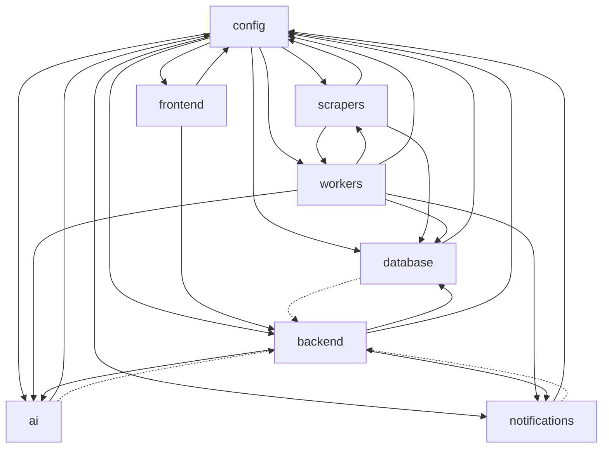
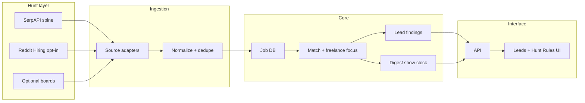

# Signal Desk Architecture

## 1. Vision

**V1 Discovery Desk:** find real freelance/contract opportunities outside crowded marketplaces, rank them against **Hunt Rules**, and send users to the **original listing** via Leads + email digest. No fake inventory. No auto-apply.

Product loop:

```
Hunt Rules → hunters (API / SerpAPI / Reddit) → ingest + dedupe → match
         → Leads (live) + digest (show clock) → Open original
```

Two clocks: **hunt** (system fills the shared pool) and **show** (per-user digest schedule).

Key qualities:
- Modular hunters (`fastapi/app/ingestion/sources.py` + `app/integrations/`)
- Easy to add new sources independently
- Clean architecture with strong separation of concerns
- Repository pattern for persistence
- Service layer for business logic
- Dependency injection for replaceable implementations
- Fully typed contracts and explicit interfaces

**V1 default hunters:** `serpapi_freelance`, `serpapi_jobs`, `serpapi_companies`.  
**Post-V1 opt-in:** `reddit_hiring` (`POST_V1_HUNTERS`). Marketplaces stay registered but off the default schedule.

## 2. Top-level modules

- `backend/` — API, application services, use cases, authentication, and business orchestration.
- `frontend/` — React/Next.js UI for preferences, dashboards, job review, and notifications.
- `scrapers/` — source connectors, source-specific adapters, normalization and source metadata.
- `workers/` — background orchestration, scheduler, queue consumers, enrichment pipelines.
- `database/` — persistence models, repository implementations, migrations, and read/write adapters.
- `notifications/` — delivery channels, notification templates, sender adapters, throttling.
- `ai/` — ranking, preference modeling, semantic matching, embeddings, and AI orchestration.
- `config/` — shared configuration, environment schema, dependency injection wiring, secrets.

## 3. Folder structure

```
freelance_automation/
  backend/
    application/
      services/
      use_cases/
    domain/
      entities/
      value_objects/
      repositories/
    infrastructure/
      repositories/
      external_adapters/
    tests/
  frontend/
    app/
    components/
    features/
    services/
    types/
  scrapers/
    core/
    sources/
      upwork/
      freelancer/
      remoteok/
      linkedin/
    scripts/
    utils/
    tests/
  workers/
    scheduler/
    jobs/
    services/
    queues/
    tests/
  database/
    (models and migrations currently in fastapi/)
    tests/
  notifications/
    channels/
      email/
      slack/
      sms/
      push/
    templates/
    services/
    tests/
  ai/
    services/
    models/
    prompts/
    adapters/
    tests/
  config/
    settings/
    di/
    validators/
    tests/
```

### Internal module structure

- `backend/application/` contains service layer classes and use-case orchestrators.
- `backend/domain/` contains entities, aggregates, value objects, and repository contracts.
- `backend/infrastructure/` contains concrete adapters for repositories, auth, external APIs.
- `scrapers/sources/` contains independent implementations for every source.
- `workers/jobs/` contains job functions for ingestion, matching, enrichment, and delivery.
- `database/repositories/` contains repository implementations behind data access interfaces.
- `ai/services/` contains ranking, intent classification, and feedback loop services.

## 4. Module responsibilities

### `backend`
- Expose a stable HTTP/REST or GraphQL API for the frontend and internal services.
- Provide business use cases through a service layer.
- Coordinate `JobMatchService`, `UserPreferenceService`, `NotificationService`, and `AIService`.
- Enforce domain rules and orchestrate cross-module workflows.
- Depend on abstractions from `database`, `ai`, and `notifications` via interfaces.

### `frontend`
- Present Desk, Leads, Hunt Rules, and account surfaces (Sources demoted from primary nav).
- Allow users to define Hunt Rules (keywords, budget, location, freelance focus, digest show clock).
- Primary lead CTA is Open original; Save/Skip persist via API.
- Call backend APIs for findings, scrape, billing, and health/status.

### `scrapers`
- Implement every source connector independently in `sources/<source-name>/`.
- Normalize raw source payloads into a canonical `JobOpportunity` domain shape.
- Provide source metadata, health checks, rate limits, and pagination.
- Publish normalized jobs into a queue or persistence layer.
- Be source-agnostic and depend only on `config` and adapter contracts.

### `workers`
- Schedule scraping cycles and run source-specific ingestion jobs.
- Consume normalized jobs for enrichment, deduplication, and matching.
- Execute background workflows such as preference retraining, alert batching, and cleanup.
- Manage queue processing and retry policies.
- Use `database`, `ai`, `notifications`, and `scrapers` through contracts.

### `database`
- SQLAlchemy models live in `database/models/` (jobs, users, applications, notifications, roadmap, etc.).
- Alembic config/migrations live in `database/` (`alembic.ini`, `migrations/`).
- Repository implementations live in `backend/infrastructure/repositories/`.
- The FastAPI app (`fastapi/`) is the HTTP surface; workers reuse the same models/session layer.

### `notifications`
- Implement channel adapters for email, SMS, push, Slack, etc.
- Define notification templates and message payload models.
- Provide `INotificationSender` and `INotificationRepository` abstractions.
- Support batching, retries, delivery status, and user opt-in/out.

### `ai`
- Provide ranking, scoring, semantic matching, and personalized relevance.
- Implement preference modeling, signal enrichment, and feedback learning.
- Offer adapters for different AI providers / LLMs.
- Expose services like `JobRankingService`, `PreferenceModelService`, and `MatchScoringService`.

### `config`
- Centralize environment variables, secret loading, and typed settings.
- Expose an application-wide dependency injection container.
- Define validation rules and feature flags.
- Provide service registration for repositories, senders, and adapters.

## 5. Clean architecture and patterns

The system follows Clean Architecture in each module:
- Entities and value objects live in `domain/`.
- Use cases and service layer code live in `application/`.
- Interface adapters and concrete implementations live in `infrastructure/` or module-specific adapters.
- External frameworks and UIs depend on the application via explicit ports.

Patterns used:
- Repository Pattern for persistence boundaries.
- Service Layer for business logic and orchestration.
- Dependency Injection for all cross-cutting module wiring.
- Interface segregation so each adapter implements only the methods it needs.
- Open/Closed principle for new scrapers and notification channels.

## 6. Dependency graph



### Graph explanation
- All modules depend on shared `config` for settings and wiring.
- `scrapers` are independent ingestion adapters and do not depend on `backend`.
- `workers` orchestrate ingestion and match pipelines.
- `backend` depends on the persistence, AI, and notification contracts.
- `frontend` depends only on `backend` and shared typings if needed.

## 7. Data flow



### Data flow summary
1. Hunters fetch public listings (SerpAPI spine by default; Reddit when keyed + opted in).
2. Ingest normalizes, dedupes, and stores jobs with original URLs.
3. Matching + freelance focus ranks against Hunt Rules; Save/Skip filters findings.
4. Live Leads serve on demand; digests fire on each user’s show clock.
5. Frontend primary path: Open original (pitch on the source site).

## 8. Core interfaces

### Input / source contracts
- `IJobSourceAdapter`
  - `fetchJobs(sourceConfig): Promise<RawJobPayload[]>`
  - `normalize(rawJob): JobOpportunity`
  - `healthCheck(): Promise<SourceHealthStatus>`

- `ISourceMetaRepository`
  - `getSourceById(id): SourceMetadata`
  - `saveSourceHealth(status): void`

### Persistence contracts
- `IJobRepository`
  - `save(job: JobOpportunity): Promise<JobEntity>`
  - `findByExternalId(sourceId, externalId): Promise<JobEntity | null>`
  - `findPendingForMatch(): Promise<JobEntity[]>`

- `IUserPreferenceRepository`
  - `getPreferences(userId): Promise<UserPreferences>`
  - `savePreferences(preferences): Promise<void>`

- `IReadModelRepository`
  - `getDashboardSummary(userId): Promise<DashboardSummary>`

### Service contracts
- `IJobMatchService`
  - `match(job: JobOpportunity, preferences: UserPreferences): Promise<MatchResult>`
  - `batchMatch(jobIds: string[], userId: string): Promise<MatchResult[]>`

- `IJobEnrichmentService`
  - `enrich(job: JobOpportunity): Promise<EnrichedJob>`

- `IAIPreferenceService`
  - `score(job: JobOpportunity, preferences: UserPreferences): Promise<ScoreResult>`
  - `retrain(userId: string, feedback: FeedbackEvent): Promise<void>`

- `INotificationSender`
  - `send(notification: NotificationPayload): Promise<NotificationOutcome>`
  - `batchSend(payloads: NotificationPayload[]): Promise<NotificationOutcome[]>`

### Infrastructure / cross-cutting contracts
- `IConfigProvider`
  - `get<T>(key: string): T`
  - `validate<T>(schema: Schema<T>): T`

- `IQueueClient`
  - `publish(topic: string, payload: unknown): Promise<void>`
  - `consume(topic: string, handler: (payload) => Promise<void>): Promise<void>`

## 9. Adding a new source

A new source is added by:
1. Creating a new folder under `scrapers/sources/<source-name>/`.
2. Implementing `IJobSourceAdapter`.
3. Adding source metadata and configuration in `config/`.
4. Registering the new adapter in dependency injection.
5. Adding a worker job in `workers/jobs/` that schedules the new source.

This keeps each source isolated and the rest of the system unchanged.

## 10. Existing workspace alignment (current)

- `fastapi/` — product HTTP API (routes under `/` and `/api/v1`)
- `backend/` — application services (scrape, match, apply, billing, notifications)
- `frontend/` — Next.js Signal Desk UI
- `scrapers/` — source adapters (HTTP boards + experimental Playwright)
- `workers/` — Celery app (`worker` + `beat`) for background scrape/drip/notify
- `database/` — models + Alembic migrations
- `ai/` — optional LLM providers for enrichment/drafts
- `config/` — shared settings

Matching used by the live product is `MatchingService` (`backend/application/services/matching.py`).
`DomainJobMatchService.batch_match` is available for DI callers when job/preference loaders are injected.

---

## 11. Recommended next step
Keep commercial source allowlists (`COMMERCIAL_*` / `RESTRICTED_*`) as the single source of truth for docs and billing features.
