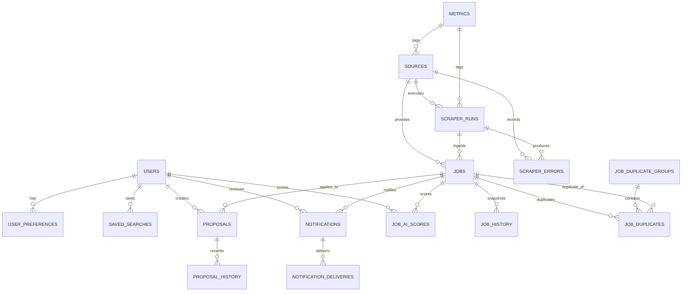

# PostgreSQL Database Design for Freelance Intelligence Platform

## Overview
This design supports:
- multiple freelance/job sources
- multiple users and saved searches
- AI scoring and user personalization
- duplicate detection across sources and repeated scrapes
- job history and change tracking
- notifications and delivery status
- user preferences and proposal history
- scraper runs, errors, and operational metrics

The schema is intentionally normalized for data integrity, with partitioning on high-volume event tables and strong indexing for query performance.

## ER Diagram

## Tables and responsibilities

### `users`
- Stores platform users and authentication metadata.
- One user can have multiple saved searches, preferences, notifications, proposals, and AI scores.

### `sources`
- Represents freelance/job marketplaces or APIs.
- Captures source metadata, official domain, status, and crawl budget.

### `scraper_runs`
- Records ingestion attempts for each source.
- Useful for monitoring run health, duration, and throughput.

### `scraper_errors`
- Captures source-specific and system errors generated during scrape runs.
- Supports troubleshooting and alerting.

### `saved_searches`
- Stores user-defined query criteria for recurring searches.
- Includes active flags, scheduling hints, and history of execution.

### `user_preferences`
- Stores per-user preference models and notification settings.
- Includes thresholds, source preferences, and optional JSON metadata for advanced AI signals.

### `jobs`
- Canonical job/opportunity table for normalized opportunities.
- Partitioned by ingestion time to support large volumes.
- Includes duplicate grouping information and normalized metadata.

### `job_history`
- Immutable snapshot table for every historical change to a job.
- Helps track price/description changes and event history.

### `job_duplicate_groups`
- Groups duplicate job records together across sources.
- Enables canonical selection and deduplication logic.

### `job_duplicates`
- Connects duplicate jobs to a duplicate group.
- Stores the detected duplicate reason and fingerprint.

### `job_ai_scores`
- Stores AI-generated relevance scores and model outputs.
- Supports both system-level and personalized scores by user.

### `notifications`
- Records notification events for job matches, digests, and alerts.
- Supports cross-channel delivery metadata.

### `notification_deliveries`
- Tracks per-channel delivery attempts, status, and response codes.

### `proposals`
- Stores proposal attempts and application data for jobs.
- Supports status lifecycle, user notes, and attached documents.

### `proposal_history`
- Records each status change for proposals.
- Provides auditability for application workflows.

### `metrics`
- Generic event metric table for operational observability.
- Stores counters and gauges with optional tags.

## Indexes and foreign keys

The schema includes the following high-value indexes:
- Unique user lookup on `users(email)` and `users(external_id)`.
- `sources(name)`, `sources(domain)` for fast source discovery.
- `scraper_runs(source_id, started_at)` for run history queries.
- `jobs(source_id, external_id)` unique constraint to deduplicate same-source items.
- `jobs(duplicate_group_id, created_at)` to fetch canonical groups quickly.
- `jobs(task_status, ingested_at)` and `jobs(search_vector)` to support job match queries.
- `job_ai_scores(job_id, user_id, score_type)` to retrieve personalized AI results.
- `proposals(user_id, job_id, status)` for application workflow filters.
- `notifications(user_id, created_at, status)` and delivery indexes for auditing.
- `metrics(metric_name, recorded_at)` for trend queries.

Foreign keys enforce referential integrity across the domain.

## Partition strategy

### `jobs`
- Partitioned by `ingested_at` on monthly ranges.
- This supports high-cardinality ingestion load from many sources.
- Older partitions can be archived or dropped independently.

### `job_history`
- Partitioned by `recorded_at` on monthly ranges.
- Keeps snapshot writes fast even when the canonical `jobs` table is large.

### `metrics`
- Partitioned by `recorded_at` on daily ranges.
- Supports high-throughput ingest and efficient pruning.

### Optional partitions
- `notifications` and `scraper_errors` may also be partitioned by `created_at` if operational volume grows.

## Migration plan

1. Create baseline reference tables: `users`, `sources`, `user_preferences`, `saved_searches`, and `job_duplicate_groups`.
2. Create the partitioned `jobs` table with a default partition.
3. Add `scraper_runs` and `scraper_errors` for operational observability.
4. Add job history and duplicate membership tables.
5. Add AI scoring and proposal tables.
6. Add notification and delivery tables.
7. Add generic `metrics` with partitioning.
8. Create indexes, constraints, and monitoring views.
9. Populate reference data and backfill historical data after validation.
10. Add partition management automation for future months.

## Performance considerations

- Use UUID primary keys to avoid hot page contention in distributed writes.
- Partition high-volume append tables by time to keep inserts fast and queries targeted.
- Store search and filter payloads as typed JSONB alongside relational columns.
- Use GIN indexes on JSONB and text search vectors for search-heavy workloads.
- Keep normalized metadata in `jobs` for common filters while preserving full raw payload in JSONB.
- Push duplicate detection to background workers using `job_fingerprint` and dedicated lookup indexes.
- Use `notification_deliveries` as a narrow, append-only table for delivery audit logs.
- Keep `job_history` immutable and separate from `jobs` to avoid ballooning row widths on updates.

## Design decisions explained

### Why separate `job_history` from `jobs`?
`jobs` holds the current canonical state, while `job_history` preserves every change. This avoids wide row updates and enables time-travel analytics without impacting current-match queries.

### Why use `duplicate_group` abstraction?
Duplicate detection is a cross-source problem. `job_duplicate_groups` allows grouping similar opportunities and choosing one canonical record while keeping duplicates for provenance and source comparison.

### Why partition `jobs` by ingestion time?
Scraper data is append-heavy and time-ordered. Monthly partitions make large-scale retention, archival, and query pruning practical.

### Why store `criteria` and `preferences` as JSONB?
Saved searches and preferences are often semi-structured. JSONB allows flexible user-defined filters while preserving relational joins for core entity keys.

### Why a generic `metrics` table?
A single tagged metrics table supports new observability signals without repeated schema changes. It is also suitable for event-driven ingestion from workers and scrapers.

## Next step
Use this schema as the basis for concrete migrations, then implement a partition management job in `workers/` and a schema versioning strategy in `database/`.
