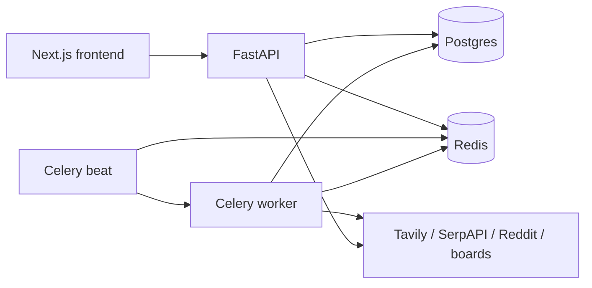

# Architecture (living)

## Module boundaries (logical — keep API paths stable)

| Module | Ownership | Primary paths |
|--------|-----------|---------------|
| **identity** | Auth, JWT, OAuth, 2FA, blocklist | `fastapi/app/api/v1/auth.py`, `users.py`, `core/security/*` |
| **discovery** | Hunters, ingestion, sources | `app/ingestion/*`, `app/integrations/*`, `scrapers/*`, `ScrapeService` |
| **matching** | Hunt Rules, scores, findings | `preferences`, `matching`, `lead_findings`, `hunt_query_builder` |
| **workflow** | Save/Skip, applications, drafts | `jobs` lead actions, `apply_service`, `proposal_draft` |
| **notifications** | Email, digest, drip, channels | `notification_service`, `digest_service`, `notifications/` |
| **billing** | Plans, Stripe, entitlements | `billing.py`, `billing` service |
| **shared infra** | Settings, DB, Redis, health, logging, workers | `config/`, `database/`, `workers/`, `health` |

Do **not** introduce a new framework. Prefer thin routers → services → repositories.

## Runtime diagram

## Two clocks

- **Hunt clock:** beat/`scrape_jobs` (+ optional in-process scheduler via `SCRAPE_INTERVAL_MINUTES`)
- **Show clock:** per-user digest window via `process_lead_digests`

## Reliability primitives (Phase 02)

- Liveness `/health/live`; readiness `/health/ready` (503 when DB/required Redis down; `degraded` when workers/beat stale)
- Request IDs (`X-Request-Id`) + error envelope `{detail, code, request_id}` (compat keeps `detail`)
- Celery overlap locks (`workers/locks.py`), run IDs, retry jitter, Redis DLQ `celery_dlq`
- Worker/beat heartbeats in Redis for readiness

## Preserve

- Dual URL prefixes (`/api/v1` + root)
- Job uniqueness / dedupe contracts
- Lead action persistence per user
- Stripe webhook signature validation when enabled
- Production JWT/CORS validators in `config.settings.Settings`
