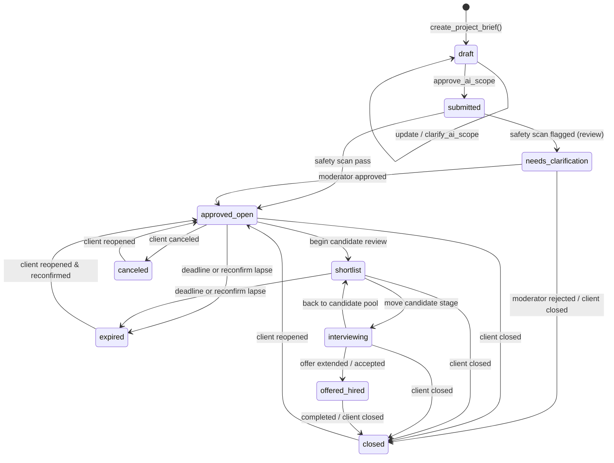

# Phase 14 Engineering Specification: Client Workspace & Proof of Hiring Intent

## 1. Architectural Overview & Context

Phase 14 delivers a structured client project creation workflow, observable hiring intent verification, candidate lifecycle management, and a human-in-the-loop moderation queue for native marketplace listings.

### Core Architectural Principles
1. **Strict Distinction from Raw Discovery**: Native projects are represented by `NativeProject` and scoped to verified employer organizations (`EmployerOrg`). They are strictly segregated from external scraped discovery leads (`JobRecord`), preserving clean separation of platform-managed work from public aggregator feeds.
2. **Private Preview Feature Flagging**: Native marketplace access remains private until Gate 18 (`FEATURE_MARKETPLACE_ENABLED=False`, `MARKETPLACE_STATUS="private_preview"`). Only signed-in members of authorized organizations or platform reviewers may access private project APIs.
3. **No Fabricated Badges or Unfunded Guarantees**: Unverified payment methods must never appear funded. Beta projects are labeled `"Unfunded / Payment Not Verified"` unless independently confirmed by an approved provider. No blanket forced deposit is mandated during beta.
4. **Free Native Applications**: Native freelancer applications strictly carry $0.00 platform fees. Demanding upfront payments, test fees, or unpaid speculative work is detected by safety filters and triggers human moderation.
5. **Periodic Reconfirmation & Stale Auto-Expiration**: Projects require active client reconfirmation every 14 days. Projects that pass their decision deadline or remain inactive without reconfirmation auto-expire with transparent abandonment codes (`expired_abandoned_unresponsive`).

---

## 2. Domain Models & Relational Schema

Additive models reside in `database/models/project.py` and are applied via migration `20261127_client_project_hiring_intent_phase14`:

| Table Name | Primary Purpose | Key Fields |
|---|---|---|
| `native_projects` | Organization-scoped project listings | `id`, `org_id`, `creator_id`, `title`, `raw_description`, `ai_scope_summary`, `ai_clarification_approved`, `primary_segment`, `scope_level`, `work_type`, `commitment_type`, `required_hours_per_week`, `budget_min`, `budget_max`, `currency`, `rate_period`, `budget_basis_notes`, `hiring_deadline`, `reconfirm_by`, `payment_verified`, `status`, `review_state`, `flagged_reason`, `duplicate_hash` |
| `project_status_histories` | Tamper-evident transition audit trail | `id`, `project_id`, `from_status`, `to_status`, `action`, `actor_id`, `reason`, `metadata_json`, `created_at` |
| `project_clarification_requests` | Structured public Q&A inquiries | `id`, `project_id`, `freelancer_id`, `question`, `answer`, `is_public`, `status`, `answered_by`, `answered_at`, `created_at` |
| `project_candidate_shortlists` | Candidate hiring pipeline tracking | `id`, `project_id`, `candidate_id`, `stage`, `notes`, `created_at`, `updated_at` |
| `project_moderation_queue` | Human-in-the-loop review queue | `id`, `project_id`, `reason_code`, `flagged_text`, `status`, `appeal_text`, `appealed_by`, `appealed_at`, `reviewed_by`, `reviewer_notes`, `reviewed_at`, `created_at` |

---

## 3. Explicit Lifecycle & Legal State Machine

Transitions are enforced by `PROJECT_LEGAL_TRANSITIONS` in `database/models/project.py`. Unauthorized or out-of-order transitions are rejected with `ValueError`:



Every transition generates an immutable record in `project_status_histories` with `from_status`, `to_status`, `action`, `actor_id`, timestamp, and client reason code.

---

## 4. Client Creation Wizard & AI Scope Clarification

### 4.1 Standardized Templates
Standardized project templates provide pre-calculated milestone structures, realistic budget ranges, and boundary constraints:
- `fastapi_backend`: Async microservices, OpenAPI schemas, Docker containerization ($2,000 - $6,000, 21 days).
- `ai_agent_pipeline`: Multi-agent orchestration, tool sandboxing, KaTeX output ($3,000 - $8,000, 28 days).
- `scraping_etl`: Headless browser pipelines, deduplication, structured storage ($1,500 - $4,500, 14 days).
- `fullstack_mvp`: Next.js frontend, FastAPI backend, PostgreSQL database ($4,000 - $12,000, 35 days).

### 4.2 AI Scope Clarification Engine (`ScopeClarificationEngine`)
The scope clarification engine parses plain-language descriptions into:
- **Key Deliverables**: Discrete demonstrable software artifacts.
- **Boundaries**: Explicit out-of-scope items preventing scope creep.
- **Acceptance Criteria**: Verifiable objective verification standards.
- **Suggested Skills**: Categorized skills matching the talent directory schema.
- **Budget Basis & Unknowns**: Explanation of basis without fabricating market averages.
- **Duplicate Detection**: SHA-256 normalized hash preventing identical duplicate job blasts within 24 hours.

### 4.3 Content Policy Safety Scanner (`ProjectSafetyScanner`)
Scans all briefs for regulatory and platform violations prior to open publishing:
- **Discrimination**: Filters age, gender, race, nationality, religious, or protected characteristic requirements.
- **Upfront Fee Scams**: Prohibits requests for candidate deposits, registration fees, or equipment purchases.
- **Unpaid Speculative Work**: Prohibits unpaid multi-day test tasks, code submissions without hire, or speculative contests.
- **Malicious Links & Telegram Outreach**: Flags obfuscated links, suspicious shorteners, or immediate Telegram off-platform redirection.

Violation handling: Projects triggering safety filters are flagged with `review_state="flagged_for_human_review"` and placed into the moderation queue rather than silently banned.

---

## 5. Observable Hiring Intent Evidence

Proof of hiring intent is computed deterministically by `ProjectService.compute_hiring_intent_evidence()` from observable platform events:

| Evidence Indicator | Verification Mechanism | Honest UX Disclosure |
|---|---|---|
| **Organization Verification** | Domain DNS verification / verified representative seat | Displays `"Verified Organization"` or `"Unverified Domain"` |
| **Payment Status** | Verified escrow/payment provider status | Displays `"Verified Escrow / Payment Method"` or `"Unfunded / Payment Not Verified"` |
| **Decision Deadline** | Hard client commitment deadline | Transparent countdown in days; auto-expires when lapsed |
| **Listing Freshness** | 14-day client reconfirmation timer | Fresh ($\le 14$d), Needs Reconfirmation ($>14$d), or Expired |
| **Application Fee** | Native marketplace platform fee | Strictly **$0.00 (100% Free)** |
| **Response & Hire Record** | Historical response rate & repeat hiring | Displays count and rate only when sample size $\ge 1$; avoids uncalibrated composite scores |

---

## 6. Public Clarification Requests & Anti-Spam

Candidates can ask clarifying questions before writing proposals:
- **Anti-Spam Rate Limit**: Candidates are restricted to a maximum of 3 clarification questions per 24 hours per project.
- **Duplicate Inquiry Detection**: Rejects identical inquiries within 48 hours.
- **Public Answers**: When a client answers a question, the Q&A becomes publicly visible on the project detail view, leveling the playing field for all applicants.

---

## 7. Moderation Review & Appeal Queue

When a project is flagged by the safety scanner:
- The project enters `project_moderation_queue` with status `pending`.
- The client receives transparent notice of the flagged reason in their dashboard.
- The client can submit a structured appeal (`POST /api/v1/projects/{id}/appeal`) explaining project context.
- Platform reviewers inspect the appeal and make human-reviewed decisions (`approved` or `rejected`) with logged reviewer notes. Accounts are **never automatically banned** solely on AI heuristics.

---

## 8. Verification & Gate Verification Matrix

The test suite in `fastapi/tests/test_phase14_client_project_hiring_intent.py` and `frontend/tests/app/client-projects.test.tsx` validates all Gate requirements:

```
============================= test session starts =============================
fastapi/tests/test_phase13_talent_employer_network.py::test_freelancer_profile_lifecycle PASSED
fastapi/tests/test_phase13_talent_employer_network.py::test_employer_org_and_seat_lifecycle PASSED
fastapi/tests/test_phase13_talent_employer_network.py::test_verification_levels_and_sandbox_provider PASSED
fastapi/tests/test_phase13_talent_employer_network.py::test_both_side_reputation_and_manipulation_checks PASSED
fastapi/tests/test_phase13_talent_employer_network.py::test_directory_discovery_privacy_and_security PASSED
fastapi/tests/test_phase14_client_project_hiring_intent.py::test_client_wizard_and_project_lifecycle_e2e PASSED
fastapi/tests/test_phase14_client_project_hiring_intent.py::test_hiring_intent_evidence_verification PASSED
fastapi/tests/test_phase14_client_project_hiring_intent.py::test_content_policy_safety_scanner_negative_tests PASSED
fastapi/tests/test_phase14_client_project_hiring_intent.py::test_clarification_requests_and_anti_spam PASSED
fastapi/tests/test_phase14_client_project_hiring_intent.py::test_reconfirmation_stale_expiration_and_idor PASSED
============================= 10 passed in 7.81s ==============================

Vitest Frontend Test Suite:
 ✓ tests/app/client-projects.test.tsx (4 tests) 190ms
 ✓ tests/app/talent-network.test.tsx (3 tests) 119ms
 ✓ All 21 test files / 57 tests passed cleanly (0 failures)
```
